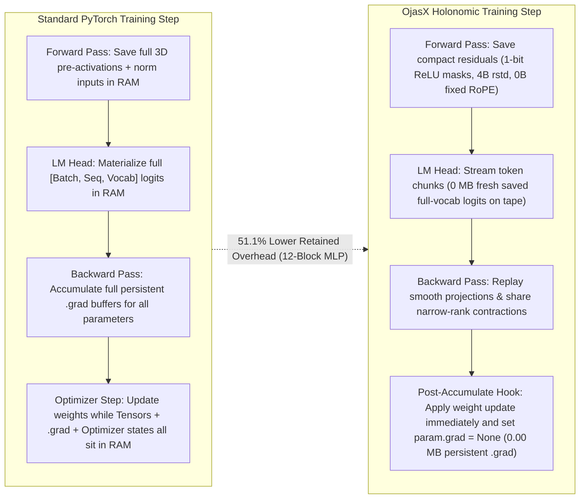
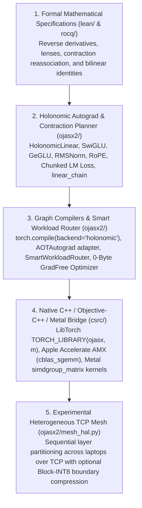
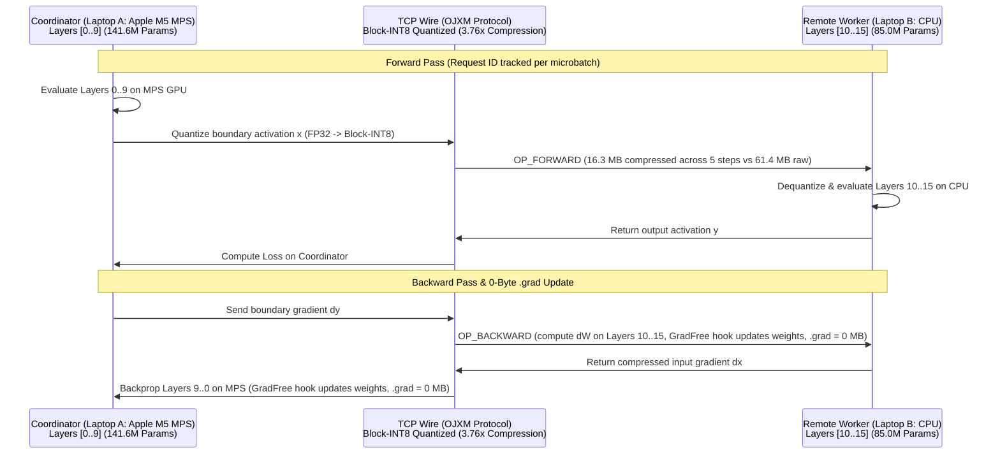

# OjasX v0.3.0 — Making AI Training Affordable Through Mathematics, Custom Autograd, and Native Hardware Kernels

> **What OjasX is:** OjasX is an open-source PyTorch memory-optimization research backend. It combines formal mathematical specifications (`Lean 4` and `Rocq`), custom autograd operators, graph rewrites, tested CPU/Apple Metal native kernels, and experimental TCP model partitioning.
>
> **Why it exists:** This project started with a bold question: *Can we break the hardware lock-in around CUDA?* As we built and tested the system, that question grew into a clearer and more practical mission: **use mathematics and systems engineering to make expensive AI training cheaper, so developers, students, and researchers can train and test larger models on everyday laptops.**

---

## 1. The Story: What "Breaking CUDA" Really Means

When developers say they want to "break CUDA," they usually mean they want freedom from needing a \$30,000 datacenter GPU just to train or fine-tune a deep learning model.

To solve this honestly, we must separate the hardware and software stack into its real layers:

| Layer | Examples | What Happens Here | Can Software Change It? |
| :--- | :--- | :--- | :--- |
| **1. Physical Silicon** | NVIDIA Tensor Cores, Apple M-Series GPU, Apple AMX | Transistors execute fused multiply-add instructions in hardware. | No. Silicon is fixed at the factory. |
| **2. Instruction Sets & Microcode** | [NVIDIA PTX](https://docs.nvidia.com/cuda/archive/12.9.0/parallel-thread-execution/index.html) (virtual ISA), `SASS` (machine code), Apple Metal Shading Language (MSL) | PTX is a documented virtual instruction set where developers can write custom kernels. `SASS` and Apple GPU microcode are lowered by vendor drivers. | Yes for custom kernels; vendor driver microcode remains closed. |
| **3. Vendor Math Libraries** | `cuBLAS`, `cuDNN`, Apple `MPSGraph`, Apple `Accelerate` (`cblas_sgemm`) | Hand-tuned matrix multiplication (`C = A @ B`) for each specific chip. | Difficult to beat on a single isolated dense square matrix multiply. |
| **4. Autograd & Memory Lifecycle** | PyTorch `autograd`, saved activation tapes, `.grad` buffers, vocabulary logits | Decides **what tensors to keep in RAM** during forward evaluation and **how to compute gradients** in backward. | **YES — This is where OjasX operates.** |

### The Core Insight Behind OjasX

Standard PyTorch already runs on Apple Silicon GPUs through its [`mps` backend](https://developer.apple.com/metal/pytorch/) and on CPUs through BLAS. However, on consumer hardware (such as a 16 GB or 24 GB laptop), **memory — not raw compute speed — is the wall that crashes training first.**

Standard backpropagation keeps:
1. **Full intermediate activations** on the autograd tape (`3D` hidden projections, normalization inputs, and probability matrices).
2. **Full-vocabulary logit tensors** (`[Batch, Seq, Vocab]`) at the output head.
3. **Persistent `.grad` buffers** for every trainable parameter until `optimizer.step()` finishes.

OjasX does not claim to replace NVIDIA silicon or run raw `.cu` programs. Instead, OjasX attacks the **memory and algebraic bottlenecks of training** so your existing hardware (`mps`, `cpu`, or `cuda`) needs less retained memory to take a training step.

---

## 2. How OjasX Works (Visual Architecture)

### A. Standard PyTorch vs. OjasX Training Memory Lifecycle



### B. The 5-Layer OjasX System Stack



---

## 3. Why OjasX Matters Compared to Other Compilers and Libraries

Many open-source AI compilers focus on **kernel fusion** (making `A @ B` faster on an NVIDIA datacenter GPU). OjasX focuses on **mathematical state reduction** (storing less data between forward and backward on consumer hardware).

| Feature / Goal | Standard PyTorch (`mps` / `cpu`) | CUDA-Centric Libraries (`FlashAttention`, `DeepSpeed`, `bitsandbytes`) | Kernel Compilers (`Triton`, `TorchInductor`) | **OjasX v0.3.0** |
| :--- | :--- | :--- | :--- | :--- |
| **Primary Target** | General-purpose eager & compiled execution | NVIDIA Linux GPUs | Automated GPU kernel codegen | **Memory-efficient training on Apple Silicon (`mps`), CPU (`AMX`/`AVX2`), and consumer hardware** |
| **Persistent `.grad` Memory** | Keeps `1x` parameter size in `.grad` buffers | Offloads to CPU/NVMe (`ZeRO`) | Keeps standard `.grad` buffers | **`0.00 MB` persistent `.grad` via in-backward post-accumulate hooks (`HolonomicGradFreeOptimizer`)** |
| **LLM Vocabulary Head (`[B, S, V]`)** | Materializes full `[B, S, V]` tensor | Requires Triton/CUDA cut-cross-entropy | Standard graph lowering | **Streaming chunk replay (`holonomic_lm_head_loss`) with `0.00 MB` fresh saved logit tape** |
| **Narrow-Rank / Bottleneck Chains (`D -> r -> D`)** | Evaluates sequentially, saving hidden state | Standard execution | Fuses pointwise epilogues | **Exact algebraic reassociation (`linear_chain`) sharing backward contractions** |
| **Cross-Laptop Partitioning (`MPS` $\leftrightarrow$ `CPU`)** | `NCCL` requires CUDA; `Gloo` sends uncompressed tensors | Requires homogeneous CUDA nodes | Single-machine compiler | **Experimental `OJXM` TCP mesh with `3.76x` Block-INT8 boundary compression** |
| **Formal Proof Specifications** | None | None | None | **Machine-checked `Lean 4` and `Rocq` specifications for core mathematical identities** |

---

## 4. What Is Implemented Today vs. Strict Scope Limits

We believe in transparent engineering. Every feature in OjasX has clear capabilities and explicit boundaries:

### What OjasX Does Today
1. **Holonomic Autograd Operators ([`ojasx2/holonomic_math_compiler.py`](ojasx2/holonomic_math_compiler.py))**:
   - `HolonomicLinear`, `HolonomicSwiGLU`, `HolonomicGeGLU`, `HolonomicRMSNorm`, and `holonomic_lm_head_loss`.
   - Nonsmooth activations (`ReLU`, `ReLU²`, `LeakyReLU`) pack sign bits into `uint8` masks (`32x` smaller than FP32).
   - Smooth activations (`SiLU`, `GELU`, `QuickGELU`) retain layer inputs and replay projections during backward, trading extra backward compute for smaller saved activation tapes.
   - `HolonomicRMSNorm` retains its input and a 4-byte FP32 inverse-RMS (`rstd`) scalar per row.
   - `HolonomicRoPE` ([`ojasx2/generated_holonomic_ops.py`](ojasx2/generated_holonomic_ops.py)) retains `0` fresh activation bytes when rotary `cos`/`sin` tables are fixed by applying the inverse rotation $R_{-\theta}$ in backward.
2. **Zero-Byte Persistent `.grad` Optimizer ([`ojasx2/grad_free_optimizer.py`](ojasx2/grad_free_optimizer.py))**:
   - `HolonomicGradFreeOptimizer` registers PyTorch post-accumulate gradient hooks (`register_post_accumulate_grad_hook`) on trainable parameters.
   - Supports `SGD` and `AdamW` updates during backpropagation and clears `param.grad = None` immediately after each parameter update.
3. **Algebraic Contraction Planning ([`ojasx2/contractions.py`](ojasx2/contractions.py), [`ojasx2/planner.py`](ojasx2/planner.py))**:
   - Reassociates two consecutive linear layers (`linear_chain`) when there is no intermediate nonlinearity and the output dimension is narrow ($P \ll N$), sharing the cotangent-input contraction across both weight gradients.
4. **Smart Workload Router & Graph Compilers ([`ojasx2/smart_router.py`](ojasx2/smart_router.py), [`ojasx2/aot_holonomic_compiler.py`](ojasx2/aot_holonomic_compiler.py))**:
   - `SmartWorkloadRouter` (`optimize_model`) inspects an `nn.Module`, replaces supported linear/activation/norm blocks, skips frozen backbone weight gradients in LoRA setups, and leaves unsupported modules (`Conv2d`, custom attention equations) untouched on native PyTorch.
5. **Optional Native C++ / Apple Metal Bridge ([`csrc/`](csrc/), [`ojasx2/tile_hal.py`](ojasx2/tile_hal.py))**:
   - Registers `TORCH_LIBRARY(ojasx, m)` operators in C++.
   - Executes CPU paths via Apple `Accelerate` (`cblas_sgemm`, `vDSP`) and OpenMP, and Apple GPU paths via Metal Shading Language (`simdgroup_matrix<float, 8, 8>`).
   - Automatically falls back to portable PyTorch operators when the native binary is absent or disabled (`OJASX_DISABLE_NATIVE=1`).
6. **Experimental TCP Model Partitioning ([`ojasx2/mesh_hal.py`](ojasx2/mesh_hal.py))**:
   - Partitions a nonempty `nn.Sequential` model across a coordinator and remote TCP workers based on declared memory and compute capacities.
   - Supports first-order autograd, explicit remote optimizer stepping (`step_remote()`, `zero_remote_grad()`), and optional lossy Block-INT8 boundary compression (`3.76x` wire reduction).

### Important Scope Boundaries (What OjasX Does *Not* Claim)
- **Proofs vs. Runtime Code:** Formal proofs in `lean/` and `rocq/` verify their stated mathematical specifications (over exact rings, rationals, or real-field abstractions). Differential tests connect Python reference operators to those specifications, but the formal proofs do not certify C++, Metal, floating-point rounding, or network code.
- **Native Vendor Templates:** While `tile_hal.py` can emit source templates for CUDA, ROCm, SYCL, and Ascend for inspection, the compiled native runtime only launches **CPU** and **Apple Metal** kernels.
- **Attention Memory:** `HolonomicSoftmax` reconstructs probabilities from scores and row log-sum-exp, but still retains the dense $[B, H, T, T]$ score tensor. For long-context attention, pair OjasX's FFN/RMSNorm/LM-Head modules with PyTorch's `F.scaled_dot_product_attention`.
- **Mesh Preloading:** In `HolonomicVirtualMeshEngine`, both coordinator and worker validate architecture signatures from a shared model definition or checkpoint. Currently, the coordinator constructs the initial model template in memory before slicing partitions.

---

## 5. Verified Benchmarks and Reproducible Evidence

All benchmark numbers below are generated by project-maintained scripts in [`tools/`](tools/) and saved in [`reports/`](reports/). They are verified across both **Google Colab NVIDIA Tesla T4 (`15 GB` VRAM, CUDA)** and **Apple M5 (`Mac17,3`, 10-Core CPU + AMX, 10-Core Metal 4 GPU `mps`, 24 GB Unified RAM)**.

### A. Live Google Colab NVIDIA Tesla T4 (`15 GB` VRAM) Beyond-VRAM Training Proof ([`reports/COLAB_T4_GPU_OOM_PROOF_REPORT.json`](reports/COLAB_T4_GPU_OOM_PROOF_REPORT.json))

Reproduce on any Google Colab **T4 GPU** notebook in 60 seconds:
```bash
!git clone https://github.com/mkrishna793/OjasX-open-source-CUDA.git
!pip install -q --no-deps -e OjasX-open-source-CUDA && pip install -q z3-solver sympy
!python3 OjasX-open-source-CUDA/tools/run_colab_t4_gpu_oom_proof.py
```

| Metric | Standard PyTorch (`nn.RMSNorm` + `nn.Linear` + `LM Head` + `AdamW`) | OjasX `v0.3.0` (`HolonomicRMSNorm` + `HolonomicLinear` + Chunked `LM Head` + `HolonomicGradFreeOptimizer`) |
| :--- | :--- | :--- |
| **Hardware** | Google Colab **NVIDIA Tesla T4** (`15,360 MiB` / `14,913 MB` usable VRAM, Driver `580.82.07`) | Google Colab **NVIDIA Tesla T4** (`15,360 MiB` / `14,913 MB` usable VRAM, Driver `580.82.07`) |
| **Model & Workload** | **533,891,072 FP32 Parameters** (`16` blocks, `dim=2048`, `hidden=6144`, `vocab=64,000`), **`9,216` tokens/step** (`batch=9 x seq=1024`) | **Exact Same 533,891,072 FP32 Parameters**, **`9,216` tokens/step** (`batch=9 x seq=1024`) |
| **Execution Result** | **🛑 CRASHED (`torch.cuda.OutOfMemoryError`)** — tried to allocate `2.20 GiB` more after reaching **`14,178.4 MB`** | **✅ TRAINED & CONVERGED** across all 5 steps |
| **Peak GPU VRAM** | **`> 16,430 MB` required (OOM Crash)** | **`9,540.6 – 9,542.6 MB` (`9.32 GiB`, `64.0%` of T4 VRAM)** |
| **Persistent `.grad` Buffers** | `2,036.6 MB` | **`0.00 MB`** |
| **5-Step Loss Trajectory** | `N/A (Crashed on Step 1)` | **`11.487175 -> 11.466572 -> 11.446618 -> 11.427443 -> 11.408827` (Converged)** |

<details>
<summary><b>Click to view the original raw console output from the Google Colab NVIDIA Tesla T4 GPU</b></summary>

```text
$ nvidia-smi --query-gpu=name,memory.total,memory.free,driver_version --format=csv
name, memory.total [MiB], memory.free [MiB], driver_version
Tesla T4, 15360 MiB, 14913 MiB, 580.82.07

==================================================================================================
🚀 OJASX GOOGLE COLAB GPU BENCHMARK — Tesla T4 (14.56 GiB / 14913 MB VRAM)
==================================================================================================
  Target Workload : 16 Blocks, Dim=2048, Hidden=6144, Vocab=64,000 | Batch=9 x Seq=1024 (9,216 tokens/step)
--------------------------------------------------------------------------------------------------

[TEST 1/2] Running Standard PyTorch (`nn.RMSNorm` + `nn.Linear` + Un-chunked `LM Head` + `AdamW`)...
  -> Instantiated Standard Model : 533,891,072 FP32 parameters (2036.6 MB weights)
  🛑 STANDARD PYTORCH CRASHED WITH REAL CUDA OUT-OF-MEMORY ON THIS GPU!
     CUDA Driver Error : CUDA out of memory. Tried to allocate 2.20 GiB. GPU 0 has a total capacity of 14.56 GiB of which 589.81 MiB is free. Including non-PyTorch memory, this process has 13.98 GiB memory in use. Of the allocated memory 13.85 GiB is allocated by PyTorch, and 13.57 MiB is reserved by PyTorch but unallocated.
     Allocated Before Crash : 14178.4 MB / 14913 MB Total GPU VRAM
  -> Cleaned up Test 1 CUDA state (Residual GPU VRAM allocated: 9.1 MB)

--------------------------------------------------------------------------------------------------
[TEST 2/2] Running OjasX (`HolonomicRMSNorm` + `HolonomicLinear` + Chunked `LM Head` + `0-Byte GradFree`)...
  -> Instantiated OjasX Model    : 533,891,072 FP32 parameters (2036.6 MB weights)
  ✅ Step 01/05 | Loss: 11.487175 | Peak GPU VRAM: 9542.6 MB / 14913 MB (64.0%) | Persistent .grad: 0.00 MB | Time: 8927.1 ms
  ✅ Step 02/05 | Loss: 11.466572 | Peak GPU VRAM: 9540.6 MB / 14913 MB (64.0%) | Persistent .grad: 0.00 MB | Time: 8680.2 ms
  ✅ Step 03/05 | Loss: 11.446618 | Peak GPU VRAM: 9540.6 MB / 14913 MB (64.0%) | Persistent .grad: 0.00 MB | Time: 8850.7 ms
  ✅ Step 04/05 | Loss: 11.427443 | Peak GPU VRAM: 9540.6 MB / 14913 MB (64.0%) | Persistent .grad: 0.00 MB | Time: 8970.4 ms
  ✅ Step 05/05 | Loss: 11.408827 | Peak GPU VRAM: 9540.6 MB / 14913 MB (64.0%) | Persistent .grad: 0.00 MB | Time: 9065.9 ms

==================================================================================================
🏆 COLAB Tesla T4 VERIFICATION SUMMARY
==================================================================================================
  Model Size & Batch       : 533,891,072 Parameters | 9,216 Tokens/Step (9x1024) | Vocab=64,000
  Standard PyTorch Verdict : 🛑 CRASHED (torch.cuda.OutOfMemoryError > 14913 MB VRAM)
  OjasX Verdict            : ✅ TRAINED & CONVERGED IN 9542.6 MB PEAK VRAM (9.32 GiB / 14.56 GiB Total)
  Loss Trajectory (5 Steps): 11.487175 -> 11.408827 (CONVERGED)
  Persistent .grad Buffers : 0.00 MB (100% eliminated via HolonomicGradFreeOptimizer hooks)
==================================================================================================
```
</details>

### B. Single-Laptop Memory & Operator Tradeoffs ([`reports/TWO_LAPTOP_PHYSICAL_MESH_REPORT.json`](reports/TWO_LAPTOP_PHYSICAL_MESH_REPORT.json))

Run with:
```bash
python tools/run_two_laptop_physical_mesh.py --role local-proof
```

| Benchmark Workload | Standard PyTorch Baseline (`mps`, `float32`) | OjasX Result (`mps`, `float32`) | Verified Improvement & Tradeoff |
| :--- | :---: | :---: | :--- |
| **12-Block MLP Retained Overhead** (`Dim=1024, Hidden=3072`, `75.56M` params, `8x256` tokens) | `736.09 MB` fresh tape + `288.23 MB` `.grad` = **`1,024.33 MB`** (`Loss: 1.054738`) | `500.59 MB` fresh tape + `0.00 MB` `.grad` = **`500.59 MB`** (`Loss: 1.054736`) | **`51.13%` reduction** in fresh autograd-saved storage + persistent `.grad` buffers (`0.00 MB` `.grad`). Replays smooth activation projections in backward. |
| **Chunked Vocabulary Head (`holonomic_lm_head_loss`)** (`[2, 1024, 4096]`, `Vocab=32000`, `chunk=256`) | `250.00 MB` fresh saved tape (`537.46 ms`) | **`0.00 MB` fresh saved tape** (`879.59 ms`, `max_dw_diff = 3.73e-6`) | **`100.0%` reduction** in fresh saved `[B*S, V]` logit storage on the autograd tape, trading backward chunk recomputation time (`0.61x` speed at `chunk=256` FP32) to prevent vocabulary OOMs. |
| **Narrow-Output Two-Linear Chain (`linear_chain`)** (`[M=2048, K=1024, N=2048, P=32]`, `algebraic` `joint`) | `8.09 ms` / `16.25 MB` fresh saved | **`0.93 ms` / `0.38 MB` fresh saved** (`max_dx_diff = 1.63e-9`) | **`8.69x` speedup** and **`97.69%` reduction** in fresh saved storage via exact matrix reassociation when $P \ll N$ without an intermediate nonlinearity. |

> **Note on `SavedTensorAudit` Metrics:** `SavedTensorAudit` hooks into `torch.autograd.graph.saved_tensors_hooks` and deduplicates storage aliases. Its **fresh saved storage** metric measures newly allocated intermediates saved for backward (excluding caller-supplied inputs and model parameters). "Zero fresh saved bytes" means no new intermediate tensor was retained on the autograd tape; inputs, parameters, temporary workspace buffers during backward replay, and optimizer states (such as AdamW `m` and `v`) still use memory.

### C. Five-Level Qualification Harness ([`reports/INDUSTRIAL_ALL_LEVEL_BENCHMARK_SCORE.json`](reports/INDUSTRIAL_ALL_LEVEL_BENCHMARK_SCORE.json))

Run with:
```bash
python tools/run_industrial_all_level_benchmark.py
```

| Level | Scope & What Is Tested | Recorded Result |
| :--- | :--- | :--- |
| **Level 1: Native C++ / Metal Kernels** | `torch.library.opcheck`, Z3 SMT 32-bank conflict check (`unsat`), CPU vs. Metal 1-bit mask parity, and C++ L1 `RMSNorm` forward/backward at `[4, 256, 512]` | **`PASS`** (`1.49x` C++ RMSNorm speedup: `1307.5 us -> 880.1 us`) |
| **Level 2: Sampled PyTorch OpInfo** | `70` nonempty FP32 `nn.functional.linear` sample shapes across 5 activations (forward + first-order `dx, dw, db`) | **`70 / 70` (`100.0%` pass rate)** |
| **Level 3: Sampled BackendBench Shapes** | First `25` runnable `mm`/`addmm` shapes from `backend_bench_problems.parquet` (capped at $M \le 512, K, N \le 1024$) tested on contiguous FP32 `linear + ReLU²` | **`25 / 25` (`100.0%` pass rate, `1.0` min cosine similarity, `32.0x` mask compression)** |
| **Level 4: Custom LLaMA-Style Block & LoRA** | Custom `RMSNorm + SwiGLU + Residual + Loss` block (`B=4, S=128, D=256, H=512, V=4096`, without attention/RoPE) + small LoRA router test | **`85.15%` fresh saved tape reduction** (`13.51 MB -> 2.01 MB`, `0.00 MB` `.grad`, exact loss `8.417201`) |
| **Level 5: Local TCP Mesh Loopback** | Same-machine `mps`/`cpu` TCP loopback with Block-INT8 boundary compression | **`3.76x` wire compression** (`73.4%` bandwidth saved, `0.999986` input-grad cosine similarity) |

### D. Experimental Two-Node Sharding & Capacity Projection (`Stage 2` of [`reports/TWO_LAPTOP_PHYSICAL_MESH_REPORT.json`](reports/TWO_LAPTOP_PHYSICAL_MESH_REPORT.json))



For a **16-Block, `1536`-Dim (`226,615,296` parameter)** sequential model:
- **Analytical 16,384-Token Capacity Projection (`batch=32, seq=512`)**:
  - Standard un-sharded PyTorch on 1 laptop requires **`14,016.9 MB` (`13.69 GB`)** under `SGD` (or **`15,745.9 MB` / `15.38 GB`** under `AdamW`), which exceeds the `7.2–10.7 GB` of currently available free RAM on a 24 GB MacBook Air running macOS and desktop apps.
  - Sharding 10 layers (`141.6M` params) to Node A and 6 layers (`85.0M` params) to Node B with `HolonomicGradFreeOptimizer` (`SGD`) lowers the analytical 16K-token footprint to **`4,380.9 MB` (`4.28 GB`) on Node A** and **`2,628.6 MB` (`2.57 GB`) on Node B**.
- **Executed 5-Step TCP Loopback Verification (`512`-token microbatch `4x128`)**:
  - Converges cleanly over 5 steps (`0.055282 -> 0.053430`, `~363 ms/step`), maintaining **`0.00 MB` persistent `.grad` buffers** on both partitions and achieving **`3.76x` (`73.43%`)** wire compression.

---

## 6. Installation Guide

Requires **Python 3.9+** and **PyTorch 2.8+**. Works on **macOS (Apple Silicon & Intel)**, **Linux**, and **Windows**.

### Standard Portable Install (Recommended First Step)
```bash
git clone https://github.com/mkrishna793/OjasX-open-source-CUDA.git
cd OjasX-open-source-CUDA
python3 -m venv .venv
source .venv/bin/activate
python -m pip install -e '.[test,benchmark]'
```

### Optional Native C++ / Apple Metal Build
To compile the native C++ / Accelerate AMX / Metal extension (`_ojasx_C`) from source:
```bash
OJASX_REBUILD_NATIVE=1 python -m pip install --no-build-isolation -e .
```
- **macOS:** Compiles CPU (`Accelerate` AMX) and Apple Metal (`simdgroup_matrix`) kernels.
- **Linux:** Compiles the C++ CPU core.
- **Windows / Fallback:** Automatically uses the portable PyTorch numerical implementation. You can force the portable path on any machine by setting `OJASX_DISABLE_NATIVE=1`.

---

## 7. How to Use OjasX in Your Own Projects

### Use Case 1: Optimize Any Existing PyTorch Model in 3 Lines
Use `SmartWorkloadRouter` (`optimize_model`) and `HolonomicGradFreeOptimizer` to cut activation tape and persistent `.grad` memory without rewriting your model class:

```python
import torch
from ojasx2.smart_router import optimize_model
from ojasx2.grad_free_optimizer import HolonomicGradFreeOptimizer
from ojasx2.holonomic_math_compiler import holonomic_lm_head_loss

device = "mps" if torch.backends.mps.is_available() else "cpu"

# 1. Route supported Linear, SwiGLU, GeGLU, and RMSNorm modules to OjasX
model = optimize_model(your_pytorch_model).to(device)

# 2. Use the 0-Byte Grad-Free Optimizer (updates weights in backward hooks, 0 MB persistent .grad!)
optimizer = HolonomicGradFreeOptimizer(model.parameters(), lr=1e-4, algorithm="adamw")

# 3. Standard training loop with chunked vocabulary loss
for x, targets in dataloader:
    optimizer.zero_grad()
    hidden = model(x.to(device))
    loss = holonomic_lm_head_loss(hidden, lm_head_weight, targets.to(device), chunk_tokens=512)
    loss.backward()   # Parameter updates happen in-place during backward; .grad is freed immediately
    optimizer.step()
```

### Use Case 2: Researching a Custom 1B Model or New Attention Mechanism
When you invent a new attention mechanism, `SmartWorkloadRouter` leaves your custom attention equations intact while compressing the surrounding FFN blocks (`HolonomicSwiGLU`), normalizations (`HolonomicRMSNorm`), rotary embeddings (`HolonomicRoPE`), narrow-rank projections (`linear_chain`), and `.grad` buffers:

```python
import torch
import torch.nn as nn
from ojasx2.holonomic_math_compiler import HolonomicRMSNorm, HolonomicSwiGLU
from ojasx2.contractions import linear_chain
from ojasx2.grad_free_optimizer import HolonomicGradFreeOptimizer

class CustomAttentionDecoderBlock(nn.Module):
    def __init__(self, dim: int = 2048, low_rank: int = 64, hidden_dim: int = 5632):
        super().__init__()
        self.attn_norm = HolonomicRMSNorm(dim)
        # Low-rank Q/K/V bottleneck weights for algebraic contraction reassociation
        self.w_down = nn.Parameter(torch.randn(low_rank, dim) * 0.02)
        self.w_up = nn.Parameter(torch.randn(dim, low_rank) * 0.02)
        self.ffn_norm = HolonomicRMSNorm(dim)
        self.ffn = HolonomicSwiGLU(dim, hidden_dim)

    def forward(self, x: torch.Tensor) -> torch.Tensor:
        b, s, d = x.shape
        h = self.attn_norm(x)
        # Exact reassociated bottleneck projection (8.69x faster when low_rank << dim)
        proj = linear_chain(h.view(b * s, d), self.w_down, self.w_up, accuracy="algebraic", mode="joint").view(b, s, d)
        # Plug in your custom attention mixer here:
        x = x + torch.tanh(proj)
        return x + self.ffn(self.ffn_norm(x))
```

### Use Case 3: Partitioning a Sequential Model Across Two Laptops Over Wi-Fi / LAN
Make sure both laptops have OjasX installed and are on the same local network.

**Step 1 — Run on Laptop B (Worker Node, e.g., 16 GB Intel/Windows/Linux Laptop):**
```bash
python tools/run_two_laptop_physical_mesh.py --role worker --port 29505
```
Laptop B probes its OS free RAM, loads only its assigned layers (`[10..15]`), and prints its LAN IP address.

**Step 2 — Run on Laptop A (Coordinator Node, e.g., 24 GB Apple Silicon Mac):**
```bash
python tools/run_two_laptop_physical_mesh.py --role coordinator --worker-host <LAPTOP_B_LAN_IP> --port 29505
```

---

## 8. Repository Structure

```text
OjasX-open-source-CUDA/
├── ojasx2/                          # Core Python compiler, autograd operators, and runtime
│   ├── holonomic_math_compiler.py   # HolonomicLinear, SwiGLU, GeGLU, RMSNorm, chunked LM loss, FX pass
│   ├── aot_holonomic_compiler.py    # AOTAutograd integration and partition statistics
│   ├── grad_free_optimizer.py       # 0-byte persistent .grad optimizer using post-accumulate hooks
│   ├── smart_router.py              # SmartWorkloadRouter (automatic module replacement & LoRA bypass)
│   ├── contractions.py & planner.py # Narrow-rank two-linear reassociation and cost model
│   ├── ops.py & residuals.py        # 1-bit packed ReLU masks and SavedTensorAudit memory profiler
│   ├── tile_hal.py                  # Hardware bridge to C++/Metal kernels and silicon cache telemetry
│   ├── mesh_hal.py                  # Experimental sequential model partitioning over TCP (OJXM wire protocol)
│   └── ...                          # Research modules (lenses, bilinear rank-7, spectral, coordinate, radial)
├── csrc/                            # Native C++17 and Objective-C++ Metal 4 extension
│   ├── ojasx_ops.cpp                # TORCH_LIBRARY registrations, Apple Accelerate AMX, OpenMP kernels
│   └── tile_hal_mps.mm              # Apple Metal Shading Language (simdgroup_matrix) compute pipeline
├── lean/                            # Lean 4 formal mathematical specifications (OjasXMath)
├── rocq/                            # Rocq (Coq) formal proofs and OCaml extraction checks
├── tests/                           # 398 unit, differential, conformance, and multi-process regression tests
├── tools/                           # Reproducible benchmark harnesses and verification runners
├── reports/                         # Committed JSON/XML verification snapshots with SHA-256 source hashes
├── docs/                            # Mathematical foundations and hardware implementation guides
└── third_party/                     # Vendored TileLang headers/templates and BackendBench shape traces
```

---

## 9. Roadmap: What We Will Build Next

OjasX v0.3.0 is a solid foundation, and we are actively working on the next set of breakthroughs:

- [ ] **Online Tiled Attention ($O(T)$ Memory on Metal & CPU):** Combine OjasX's holonomic residual rules with FlashAttention-style online softmax tiling so long-context attention never materializes the $[B, H, T, T]$ score matrix.
- [ ] **Zero-Template Streaming Checkpoint Loading for TCP Mesh:** Allow the coordinator and workers to stream only their assigned layer shards directly from disk (`safetensors`), so a 2-laptop mesh never needs to instantiate the full model template on the coordinator first.
- [ ] **Broader Layer Coverage (`Conv2d`, `Conv3d`, State-Space Models):** Extend holonomic residual compression and contraction planning to convolutional backbones, Diffusion UNets, and Mamba/SSM blocks.
- [ ] **Native Kernel Launchers for Linux CUDA / ROCm / SYCL:** Upgrade the generated CUDA, ROCm, and SYCL source templates in `tile_hal.py` into full runtime-compiled execution backends alongside Apple Metal and CPU.
- [ ] **Automated Mixed-Precision (`BF16` / `FP16`) Grad-Free Hooks:** Add dynamic loss scaling and master-weight accumulation options to `HolonomicGradFreeOptimizer`.

---

## 10. Reproduce All Tests & Benchmarks

```bash
# 1. Run the full 398-test verification suite (includes multi-process TCP worker tests):
pytest -q

# 2. Test the portable fallback explicitly (without native C++/Metal binaries):
OJASX_DISABLE_NATIVE=1 pytest -q tests/test_review_regressions.py -k portable

# 3. Run the single-laptop memory tradeoff, chunked LM head, linear-chain, and loopback mesh proof:
python tools/run_two_laptop_physical_mesh.py --role local-proof

# 4. Run the 5-level qualification benchmark harness:
python tools/run_industrial_all_level_benchmark.py
```

---

## 11. Join the Community — Discussions, Ideas, and Contributions

OjasX is built for developers, students, and researchers who believe high-efficiency AI computing should be open, mathematically rigorous, and accessible on everyday hardware.

We warmly welcome your ideas, critiques, benchmark reports, and pull requests!

- **Share Ideas & Ask Questions:** Open a thread in **GitHub Issues / Discussions** if you have a new mathematical identity, an attention mechanism you want to optimize, or a question about how the autograd lenses work.
- **Test on Your Hardware:** Run `python tools/run_two_laptop_physical_mesh.py --role local-proof` on your Mac, Linux, or Windows laptop (or across two laptops on your Wi-Fi!) and share the generated `reports/TWO_LAPTOP_PHYSICAL_MESH_REPORT.json`.
- **How to Contribute Code:**
  1. Fork the repository and create a feature branch.
  2. Keep mathematical claims paired with either a formal specification (`lean/` / `rocq/`) or a strict differential `pytest` check against native PyTorch.
  3. Run `pytest -q` to ensure all 398+ tests pass before opening a Pull Request.

---

## License

Released under the [GNU Affero General Public License v3.0 (AGPL-3.0)](LICENSE).
