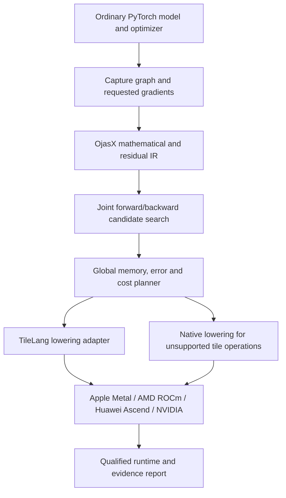

OjasX plan: reduce the training work and memory required on one accelerator

Prepared 7 October 2026. This is a research and implementation plan, not an achieved one-GPU replacement claim. No GPU, Neural Engine, training, or benchmark execution was performed for this plan.

**The product objective**

OjasX should let an ordinary developer train substantially larger workloads locally by reducing the arithmetic, data movement, and retained state of forward and reverse computation. The long-term challenge is to run selected workloads that otherwise require three or four accelerators on one accelerator, with an explicit accuracy and throughput contract. Reducing dependence on CUDA and supporting additional vendors are supporting engineering goals. A backend that merely runs the original expensive graph on another vendor does not satisfy the main objective.

The working architecture is a PyTorch-compatible compiler with mathematical optimization above a tile compiler and hardware-specific scheduling. Category theory supplies compositional derivative and adjoint semantics. Multilinear and numerical linear algebra supply possible cheaper circuits. Residual analysis supplies memory reductions. Tile scheduling turns those choices into efficient machine execution.

**What is understood from the supplied project**

The two supplied notes describe a dagger underlayer, S/A splitting, rank-7 bilinear mathematics, activation optics, Lean/Z3 verification, native C++/Metal kernels, a zero-copy allocator, a TileLang-inspired engine, and AOTAutograd/TorchInductor integration. The original PROJECT.md also explicitly includes the tile-engine goal. The original implementation and the rebuilt mathematical reference are distinct artifacts.

The [combined audit](../OjasX-combined-analysis.md) found that several original guarantees exceeded the evidence: standard linear autograd already has two backward GEMMs; a four-add decoder is not the whole gradient calculation; general GELU/SiLU/SwiGLU derivatives cannot be obtained from their output alone; native shaders contained recomputation; and memory measurements did not establish zero tensor memory. These are reasons to refine the approach, not reasons to abandon the ambition.

The rebuilt [verification report](reports/VERIFICATION.md) records 121 Lean statements, 33 scoped Z3 checks, and 209 CPU tests, with two unavailable-device skips. These qualify stated identities and finite CPU cases. They do not certify a production GPU compiler or arbitrary workloads.

**Define the one-accelerator challenge before optimizing**

Two different successes must be reported separately:

1. Capacity: the same training problem fits on one specified device.
2. Throughput: one device completes the same training problem within an agreed time, ideally approaching or exceeding a specified multi-device baseline.

Keep model, dataset, trainable parameters, global batch, context length, optimizer, learning schedule, random seeds, and accuracy policy explicit. Record gradient accumulation, distributed sharding, precision, checkpointing, CPU offload, and storage offload. Four data-parallel replicas are different from a model sharded across four devices. Their aggregate memory is not automatically the single-device memory requirement.

Changing batch or using sequential gradient accumulation can sometimes make a workload fit, but is not evidence of a mathematical arithmetic reduction. Likewise, offloading optimizer states changes placement rather than eliminating those states. Report either technique when used.

Use the peak-live model:

```text
M_peak = max_t [weights(t) + gradients(t) + optimizer_states(t)
               + saved_residuals(t) + temporaries(t) + workspace(t)
               + runtime/allocator overhead(t)]
```

Do not add each category's independently measured maximum: those maxima may occur at different times. Deduplicate aliases and shared buffers.

A straightforward all-FP32 Adam implementation with N parameters stores approximately 16N bytes for weights, dense gradients, and two moment arrays, before activations and overhead. At N = 7 billion that is approximately 112 decimal GB. Activation tiling alone cannot fit those retained arrays into a 24 GB machine. Eliminating a full gradient buffer through blockwise update scheduling can lower the peak in eligible cases, but requires handling shared parameters, accumulation, clipping, and optimizer dependencies. It does not automatically eliminate weights or moment states.

Illustrative budget, not a measured OjasX result: if live persistent state is 14 GB and activations/workspace add 66 GB, a 24 GB target leaves at most 10 GB for those variable components before overhead. That requires more than 84.8% reduction in the variable components, not merely a modest activation improvement. The device's usable budget is smaller than advertised memory, especially on unified-memory systems shared with the OS.

Time obeys a similar whole-workload constraint. If 80% of the baseline step is optimized by 8x and the remaining 20% is unchanged, the ideal overall speedup is 1/(0.2 + 0.8/8) = 3.33x. This ignores new overhead and contention. Local kernel speedups cannot simply be multiplied or equated with replacing four GPUs.

**What the DeepSeek/Huawei work provides**

The likely references are TileLang, DeepSeek TileKernels, and DeepGEMM-Ascend. The official TileLang repository documents a TVM-based tiled kernel language, CUDA/ROCm/Metal backends, and Ascend 950 support announced on 30 September 2026. It also documents a Metal 4 cooperative-tensor GEMM path for supported M5 systems. These are upstream support statements, not qualification on this laptop. [TileLang repository](https://github.com/tile-ai/tilelang), [merged M5 GEMM implementation](https://github.com/tile-ai/tilelang/pull/2252)

DeepSeek TileKernels supplies training/inference kernels, including fused normalization/gating and quantization operations, and documents NVIDIA and Ascend backends. Its current requirements differ substantially from our pinned PyTorch 2.8 runtime. A supported Metal backend in TileLang does not imply every TileKernels operation runs on Metal. [DeepSeek TileKernels](https://github.com/deepseek-ai/TileKernels)

DeepGEMM's main implementation is a CUDA kernel library with dense and grouped matrix operations. Its Ascend port preserves APIs while implementing Ascend-specific matrix primitives, layouts and pipelining. This is a useful model for sharing semantic interfaces while specializing machine schedules. [DeepGEMM](https://github.com/deepseek-ai/DeepGEMM), [DeepGEMM-Ascend](https://github.com/deepseek-ai/DeepGEMM-Ascend)

Ascend's TileLang dialect distinguishes Cube matrix operations and Vector operations, plus L1/L0/Unified Buffer storage. OjasX should describe those requirements through a capability interface rather than assume they are the same as Apple thread storage or NVIDIA shared memory. [Ascend kernel guide](https://github.com/tile-ai/tilelang/blob/main/tilelang/ascend/README.md)

Recommendation: evaluate TileLang as the first tile-lowering substrate. Keep OjasX's joint-gradient transformations, residual planning, accuracy decisions, and proof obligations above it. Use native Metal TensorOps when a needed tile operation or integration contract is unsupported. Do not begin by duplicating all of TVM, TileLang, and their runtime infrastructure.

**Compiler architecture**



This is a proposed pipeline. Target selection alone does not make a graph qualified.

Each mathematical IR node needs shapes, strides, element/accumulation types, parameter identity, demanded cotangents, residual alternatives, effects, alias/version dependencies, derivative contracts, error conditions, and theorem identifiers. Tile IR additionally needs storage scopes, ownership, transfer dependencies, barriers, launch geometry, and instruction requirements.

The planner should minimize measured or calibrated step time subject to memory and numerical budgets. Arithmetic, byte traffic, launch count, packing, validation overhead, and spills must all enter the estimate. A roofline estimate is a screening model, not a performance certificate. Smaller matrix products may have worse utilization despite fewer scalar operations.

The developer-facing target is ordinary model and optimizer code, with an eventual qualified `torch.compile(..., backend="ojasx")` integration. This spelling describes the planned production interface; the existing rebuilt backend is a scoped CPU prototype. Unsupported operators should keep an explicit native graph boundary with diagnostics. Internal AOTAutograd/Inductor APIs must be pinned and tested. Global capture, RNG, mutation, fanout, shared weights and higher-order derivatives must be covered before advertising transparent general training.

**Mathematical research priorities**

| Priority | Candidate | Existing basis | Next mathematical requirement |
|---|---|---|---|
| 1 | Demand-aware joint contraction and longer chains | Implemented finite-dimensional identities and CPU planner | General graph fanout, shared parameters, all surrounding storage, quantified rounding guards |
| 1 | Structured RMSNorm/LayerNorm segments | LayerNorm structured Jacobian and conditional Gram identities | Full analytic normalization derivative in Lean, RMSNorm extension, conditioned alternatives, workload shape analysis |
| 1 | Minimal sufficient activation residuals | ReLU packing and residual collision/sufficiency results | Dtype-specific exact representations and full activation-region contracts |
| 2 | Exact structured zero-tile skipping | Algebraic zero elimination | Demonstrate runtime structure and conservative finite-arithmetic legality, including exceptional values |
| 2 | Tiled softmax/attention backward | Row reduction identities; established IO-aware attention | Complete masked/dropout gradient semantics and residual schedule, then compare against optimized SDPA |
| 3 | Rank-7/Winograd forward and joint backward | Real/ring equivalence and cost/workspace statements | Target cost crossover, numerical stability, full training tape and workspace accounting |

For a differentiable map f, backward uses the adjoint of Df(x). Category theory makes composition and cotangent accumulation coherent. It does not imply that all Jacobians are low rank or that input and parameter gradients are interchangeable. For Y = XW, the X and W cotangents depend on different original operands. A shared tiled traversal may improve data reuse, but every requested gradient remains an output obligation.

The current favorable linear-chain and Gram-normalization results are useful prototypes. They are not a general result for a standard Transformer MLP. A wide SwiGLU block contains elementwise input-dependent gates between its projections. A compiler cannot reassociate across that gate as though it were another linear map.

For ReLU, a bit mask can represent the derivative selection more compactly than a full FP32 residual when that residual is separately needed; output reuse can already be optimal if another consumer retains it. For GELU/SiLU, keep sufficient original information unless a restricted representation has a proved contract. SwiGLU requires sufficient information for both branches. RMSNorm/LayerNorm require input/scale information and row statistics according to the chosen gradient rule. A branch bit plus floating inverse is a research candidate, not a general bit-accurate guarantee.

FlashAttention demonstrates the value of tiled, IO-aware exact attention. OjasX should compare against a current optimized attention implementation, not a baseline that needlessly materializes the full score/probability matrices. Such tiling mainly addresses memory traffic and storage; it is not proof of a universal reduction in attention's arithmetic. [FlashAttention paper](https://arxiv.org/abs/2205.14135)

**The first hardware kernels**

Build a small family before attempting an entire hardware stack:

1. Linear plus an activation with explicit residual output, and its complete input/weight/bias backward.
2. RMSNorm forward/backward using row reductions and sufficient residuals.
3. SwiGLU forward/backward with both projection gradients preserved; use shared input reads where profitable.
4. Attention backward with streaming softmax statistics and supported masking/RNG semantics.
5. The selected joint contraction/normalization circuits, with their smaller GEMMs and measured conditioning.

For each kernel define input/output layouts, tail handling, accumulation precision, residual bytes, scratch bounds, alias restrictions, synchronization, and rejection conditions. Tune forward and backward together; their matrix shapes and preferred layouts differ. Cache packing only while a parameter version is unchanged and charge each repacking cost.

Apple's MPP guidance recommends hierarchy-aware tiling, cooperative tensors, cache-conscious traversal, and shape-specific tuning. It specifically says explicit threadgroup-memory staging is not necessary for its most optimized GEMM kernels. OjasX must therefore specialize memory strategies instead of copying one vendor's double-buffering recipe to all hardware. The M5 GPU's matrix accelerators are separate from the Neural Engine. [Apple MPP guide](https://developer.apple.com/download/files/Metal-Performance-Primitives-Programming-Guide.pdf)

The initial Apple route is a direct PyTorch/Metal adapter, or TileLang's qualified Metal integration. MLX can serve as a numerical reference and kernel-prototyping path; migrating every user's model to MLX is not the product interface. Cross-framework buffers require real ownership, lifetime, stream and layout qualification before any zero-copy claim.

Current MLX documentation allows reduced-precision float32 matrix operations by default; an initial full-FP32 reference must disable that path explicitly. Fully FP32 typed Core ML programs exclude Neural Engine placement in Apple's documented route. Thus ANE should be evaluated as a separate precision-qualified backend rather than a prerequisite for the central one-GPU objective. [MLX numerical precision](https://ml-explore.github.io/mlx/build/html/usage/precision.html), [Core ML typed execution](https://apple.github.io/coremltools/docs-guides/source/typed-execution.html)

**Whole-model memory planning and optimizer scheduling**

Build a lifetime graph for unique storage across the entire training step. Include views, aliases, fanout, saved versions, RNG state, asynchronous completion, gradient accumulation, optimizer state and library workspace. Reuse buffers only after their final use on every relevant stream.

Keep three separately reported policies:

- Same-model, same-optimizer storage/schedule transformations, with strict or declared numerical contracts.
- Optional checkpoint/recompute or CPU/storage offload, with the added FLOPs, transfers and time included.
- Optional approximate compression, reduced precision, sparsification, or changed training methods, requiring their own accuracy evidence.

A blockwise optimizer schedule is an important research candidate. After a parameter's complete gradient has arrived, finish its update and release that gradient where legal. If the old parameter value is still needed for another backward operation, postpone the update or retain the needed old value and account for it. Shared weights, multiple microbatches, global gradient clipping and optimizer closures impose barriers. Premature updates would change training. Lossless state encoding is valuable when compressible structure exists, but arbitrary dense FP32 states have no universal fourfold lossless compression guarantee.

**Implementation sequence and acceptance gates**

| Phase | Concrete deliverable | Gate before advancing |
|---|---|---|
| 0: challenge definition | One dense decoder-style training configuration, one normalization-heavy workload, one unfavorable control; memory/time breakdown and accuracy contract | Reproducible optimized-native baseline; distinguish capacity and throughput targets |
| 1: semantic contracts | Extend the current theorem/rule registry and normalization/activation contracts | All original parameters and cotangents preserved; explicit residual and machine obligations |
| 2: global planner | Joint candidate selection, residual lifetime graph, byte-accurate peak model and Pareto time/memory choices | Account for aliases, packing and simultaneous live buffers; prediction agrees with observed traces within a preregistered tolerance |
| 3: one Metal path | Version-pinned TileLang evaluation, first kernel family and native TensorOps escape hatch | Actual GPU execution, no hidden CPU fallback, forward/all-gradient conformance and full memory/time evidence |
| 4: ordinary PyTorch integration | AOT joint capture, guarded region partitioning, registration and cache | Fanout/shared-weight/RNG/mutation tests, higher-order policy, documented unsupported boundaries |
| 5: full-model qualification | Dense Transformer block stack, real-data training, optimizer trajectories and ablations | Same problem/optimizer/batch; measured capacity and end-to-end time; declared model-quality acceptance |
| 6: second vendor | Qualify AMD or Ascend on available hardware | Same semantic suite plus independently qualified machine schedules and numerical behavior |
| 7: one-device demonstration | Selected workload runs on one device against its documented 3–4-device baseline | Publish per-device and aggregate memory, throughput, quality, offload/recompute, energy where measurable, and reproducible artifacts |

Do not assign a calendar promise to unresolved mathematical discoveries or inaccessible hardware. Phases 0–2 can progress through source work, proofs, static compiler tests and CPU reference experiments. Hardware performance gates need a usable device context. The user's present instruction is to plan and research without executing workloads.

The first useful vertical slice should cover a repeated pre-norm dense Transformer block with attention and a SwiGLU MLP, plus the existing favorable Gram-normalization segment and wide/irregular negative controls. The native Transformer block establishes whether the work benefits representative architecture rather than only artificial adjacent linear chains. Start within the available device's capacity; scaling a successful slice is a later measurement.

**Proposed source additions**

These names are planned work, not existing modules:

| Path | Purpose |
|---|---|
| `ojasx2/ir/semantic.py` | Tensor, derivative, effect, alias and residual contracts |
| `ojasx2/ir/tiles.py` | Target-neutral tile dependencies and memory scopes |
| `ojasx2/planning/liveness.py` | Unique storage lifetimes across forward/backward/update |
| `ojasx2/planning/cost.py` | Arithmetic/traffic/launch/error estimates and calibrated target costs |
| `ojasx2/planning/search.py` | Guarded candidate search under memory and error budgets |
| `ojasx2/backends/tilelang.py` | Pinned tile-lowering and execution adapter |
| `ojasx2/backends/metal.py` | Apple capabilities, native escape hatch and stream/buffer contracts |
| `ojasx2/runtime/training.py` | Safe gradient accumulation and optional blockwise optimizer schedule |
| `lean/OjasXMath/Normalization.lean` | Full normalization derivatives and explicit conditioning assumptions |
| `lean/OjasXMath/GraphRefinement.lean` | Graph-level cotangent and residual transformation obligations |
| `tools/benchmark_training_capacity.py` | Whole-step memory/time/quality and capacity challenge reports |

Extend and reuse current `compiler.py`, `planner.py`, `nonlinear.py`, `contractions.py`, `residuals.py`, and the existing Lean foundations instead of maintaining duplicate implementations. Preserve the original production tree as the audited reference until replacement contracts are qualified. Pin a separate tile-development environment rather than silently upgrading the already checked PyTorch 2.8 environment to match upstream TileKernels.

**Verification and evidence**

Lean checks stated mathematical derivative, contraction, residual and schedule identities. Z3 checks precisely modeled index bounds, layout injectivity, discrete schedule legality, bit packing and bounded machine cases. Neither solver certifies unmodeled hardware timings or arbitrary floating reductions. Proof identifiers must eventually be tied to instantiated compiler transformations, not merely placed in comments.

Device qualification must cover all requested gradients, exceptional values, odd/empty dimensions, version/alias behavior, shared parameters, optimizer trajectories and selected second derivatives. Raw-bit equality is meaningful only against a pinned backend and operation contract. Algebraic reassociation needs a numerical budget and conditioning-aware fallback; tolerance success on random inputs alone is insufficient.

Benchmarks must count main GEMM arithmetic, auxiliary arithmetic, memory traffic, peak live device storage, allocator reserve, host/unified memory, launch count, kernel spills, compilation and amortized packing costs, forward/backward/update time and end-to-end tokens/s or samples/s. Report checkpointed and optimized-library baselines, warm and cold behavior, distributions across runs, and negative controls. Account for recomputation inside kernels, not only operator names or dispatch counts.

Required ablations: native; OjasX math only; memory scheduling only; tiling only; full combination. This reveals which component actually supplies the improvement and prevents double-counting overlapping savings.

The main immediate deliverable is therefore a global joint computation/residual planner and one complete, verified training-block lowering. A universal half-cost backward theorem, universal zero activation memory, or universal four-GPU replacement is not a premise of this plan. Selected workload reductions are the milestones from which a broader system can be built.
